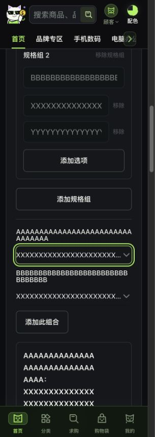
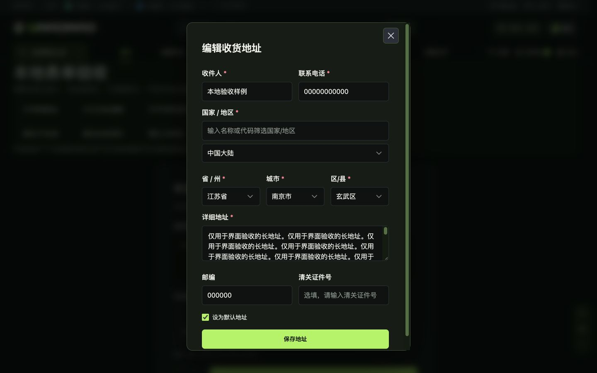

# v47 去重后的前端状态补查

2026-10-16，`main@9ddd348`及当前本地改动。**本批源码修复、受控回归及恢复后6项本地浏览器补查已完成；v47整体验收仍部分完成。** 未提交、推送、发布或更新跨设备承接快照。既有图库、手机输入、分类及去重改动全部保留。

## 本批修复

1. **特殊字符显示**：商品买手、评价作者、聊天发送者和会话列表头像保留完整首码点；普通文字、空名回退与匿名隔离不变。评价摘要沿用85个UTF-16单位的阈值及展开逻辑，只移除截断末尾的半个代理对，不宣称完整组合emoji字素支持。
2. **媒体节点生命周期**：撤回、ID/类型/媒体源变化、卸载时停止旧音视频并清空src；身份/重试节点隔离，迟到错误不污染当前消息。普通元数据更新和recalled的undefined↔false不打断播放。样式、控件和接口未改。
3. **长规格撑宽**：同生产层级的DEV样例实测320px时，SKU根宽239px却生成620.5px隐式列；701px窄编辑栏同样越界。仅将组件单列改为`minmax(0,1fr)`并给动态组名label增加`overflow-wrap:anywhere`，保留间距、字段、按钮和断点。1440px修前/后根宽1037、标签447.5、金额/库存输入489.5及控件右边界一致。
4. **配色面板键盘循环**：折叠details中的隐藏参考链接仍被焦点组件当作末项，导致summary按Tab跑到body，反向循环失败。仅在展开时挂载6个原链接，同步原生toggle，重开复位折叠；保留原details/summary、链接、文案、样式和配色。未改公共FocusScope。

本批5个生产SFC（message-bubble、v47-detail-reviews、product/detail、im/index、theme-picker）的style块与HEAD逐字一致。SKU只改上述两条内部收缩规则，没有改冻结CSS/素材、主题、H5、包/锁文件或后端。

## 恢复后的6项浏览器结果

只使用Chrome、本地5173 DEV入口及当前MEME配色；没有切换配色、业务上传、地址保存、退款提交或业务消息发送。

| 步骤 | 结果及证据 |
| --- | --- |
| 1 长品牌/标题、28+8金额、32/64字符SKU | 320/375/700/701/1440分别测量，实际document宽与client宽相等；手机控件和长标签收回容器，375长选项下拉位于x16至359。701修后标签174px且scroll174，SKU360px；1440几何与修前一致。见resume-browser-checks.json。701中卡片隐藏的探索按钮有离屏坐标但受祖先裁切，未撑开文档，不当成可见溢出 |
| 2 长地址与六图售后 | 沿用已验1024长地址；补1440长地址，弹窗540×792、保存按钮位于795至841px。1024/1440售后六图均解码成功、94px方图按5+1换行，预览/删除/取消/提交按钮均在表单宽度内，Tab可达；未提交。见resume-browser-checks.json及01/04/05截图 |
| 3 评价配图连续反向 | 375和1440按300开/420关/500重开/1300关采集。1440共198帧、最大间隔21.4ms；375首次166帧含154.3ms缺口，不接受为平滑轨迹；单独补采197帧、最大27.3ms。两组有效轨迹最多1个遮罩、最终清空并回原按钮。重开重建节点，未改原型动效。见photo-motion-*.json；只证明DOM轨迹/清理，不代表逐帧绘制或全站动画通过 |
| 4 配色面板键盘 | 修前真实复现；修后700和1440初焦点均为当前选中配色，折叠summary Tab→关闭、关闭ShiftTab→summary；700展开后末链接Tab→关闭，Escape返回入口，无残留遮罩，重开恢复折叠；配色始终web3-meme。见theme-focus-after.json |
| 5 筛选快速重开及700→701 | 700快速关闭/重开后保持一个dialog、焦点在关闭；701退出手机dialog并清空body锁定，焦点不留隐藏面板；回700后可打开，Escape回筛选入口且解锁。见filter-reopen.json |
| 6 本地WAV真实播放与失效节点 | Chrome解码30秒静音WAV，readyState4、paused=false，撤回前已播放7.748577秒；撤回/换源/移除后旧节点均paused=true、src=null、readyState0且离开DOM。换源保留一个新audio，另外两项audio归零。见local-media-playback.json。未覆盖远端文件、video、录制上传或服务端撤回 |

截图保留Chrome原JPEG及同像素PNG副本，均已打开检查；01为1024×900，03为305×858，04为1440×900，05为1009×887。03/05是浏览器可见内容截图，含滚动条及可见区裁切，不能当作完整320×900/1024×900视口像素对照。早期02截图未呈现SKU问题，不纳入证据并已移除；修前尺寸来自当时真实DOM测量。

## 去重、工具恢复及剩余边界

- SKU删除确认候选经唯一生产消费者确认：draftRevision重挂载并关闭旧确认，回调有active/disabled保护，不新增防御代码。Reka已有打开前焦点捕获，不重复写回焦。
- 既有分享轨迹、图片重试、基础表单/键盘及27字段配色不重跑。旧36组多断点结论继续撤回；本批只补当前配色缺失断点，不恢复三配色六断点声明。
- 上次平台访问限制后立即停止；用户恢复后只访问本任务localhost标签。期间扩展超时及其他Chrome前台切换导致采样中断，未返回的步骤未计通过；恢复自有标签后逐项完成。没有绕过访问限制或用其他浏览器替代。最终视口reset并确认回2048×871、无面板/遮罩，临时标签已关闭，5173服务保留，见cleanup.json。
- DEV boundary只用真实组件及显式本地文本、金额、静音PCM；规格包装镜像生产结构，阻断上传、demo收藏及业务发送。DEV入口不进入正常生产构建，不是接口失败回退。
- 真实iOS/Android软键盘、自动缩放、旋转和安全区仍需实机；远端媒体及既有业务/角色/样本验收仍按design-qa去重清单。未宣称整站像素、连续绘制和真实交易闭环完成，未新增后端整改。

## 自动验证与交付

既有9文件 **324项测试通过**；`pnpm typecheck`、参考契约（17CSS/129素材/50商品/27主题及本地入口守卫）、`git diff --check`和`pnpm build`通过。8项新增回归均在既有测试文件，没有新框架或依赖。配色新测试只证明真实setup状态同步，不代替上述Chrome焦点证据。未commit、push或发布，未更新顶部跨设备承接。
