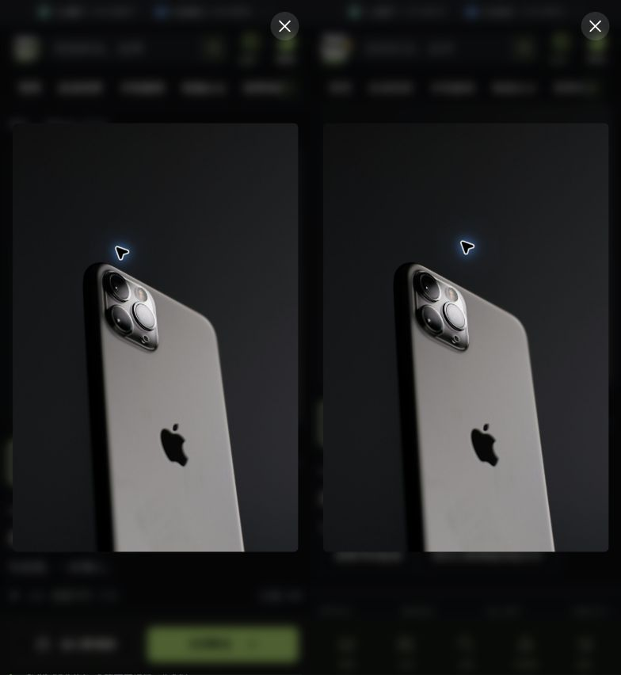
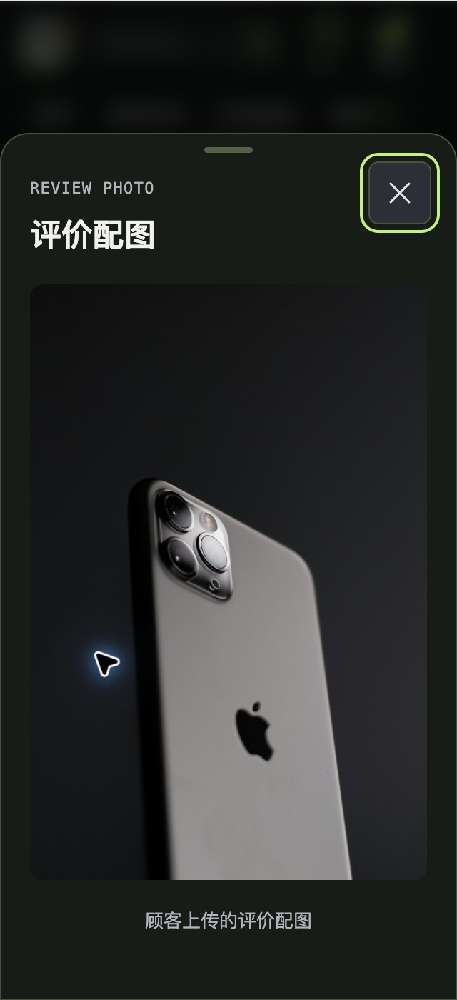

# v47 商品图库恢复与手机预览

2026-10-16，基线 `main@9ddd348`。已重试完成 fetch，`git pull --ff-only origin main` 提示已是最新。本批局部修复及验收完成，v47 整体仍部分完成；没有提交、推送或发布，没有更新接口计划顶部承接快照。

## 修复

商品主图或缩略图加载失败后，原组件将 URL 留在失败集合，切换缩略图仍直接返回占位图，放大按钮持续禁用。同一商品未换图片数组时没有原地恢复路径。

现在点击已有缩略图会只清除该 URL 的失败标记，重新加载原图；仍失败就继续显示占位，不自动循环请求，也不清除其他图的失败状态。失败缩略图补充“重试商品图片”和悬停说明，正常态标签、按钮数量、模板结构、样式及动画不变。生产消费者仍使用原组件、原商品数据和 SKU 换图规则。

既有 page.test.ts 增加一项真实组件 setup 回归：两张图分别失败，只重试选择的图片；再次失败后切换另一图不会误清前图。修前命中占位图断言失败，其余 303 项通过；修后定向和全量均通过。没有新增测试文件或框架。

## 当前运行的步骤与证据

| 步骤 | 结果 | 证据与准确边界 |
| --- | --- | --- |
| 1 图片失败与原地重试 | 通过 | Chrome 原生 DevTools Elements 仅将本地验收主图 DOM 的 src 临时改成不存在的 `/__qa-image-missing.jpg`，触发浏览器实际图片错误。页面显示占位、禁用放大并提供原缩略图重试标签；点击后原 URL 与 1000×1500 原图恢复，放大可用。见 image-failure-before-retry.json、image-retry-recovered.json、10/11/12 图片。不是生产 CDN 断网/超时验收，没有改组件数据源或伪造成功接口 |
| 2 多图选择与大图关闭 | 局部通过 | 375×812 下选第二张 1000×1000 原图，放大使用第二张；Escape 回到主图触发按钮。02 为实现该状态；此处不登记375px原型像素对照，可靠原型对照见下一步的原生设备工具截图。大图沿用原型单图展示，不新增翻页 UI |
| 3 手机竖图与配图抽屉 | 局部通过 | Chrome 原生 Device Toolbar 的 iPhone 15 Pro：393×852 CSS、DPR3，同一 1000×1500 竖图；双方图片矩形均 x16/y155.25/361×541.5，关闭按钮均 x342/y15/36×36。15/16 保存图均实际 392×852，17 为无缩放并排，已打开检查；图像比例、完整展示和关闭位置一致，但有鼠标指针、背景业务内容差异及截图少一列的工具边界，不称全页像素零差分。另在 320×700 下评价配图抽屉矩形 y92.8125/320×607.1875、底部700，原生 08 及其不缩放截取 18 确认图片、说明和关闭按钮均完整；不是实机键盘或安全区验收 |
| 4 分享快速反向 | DOM 轨迹通过 | 复用已有 DEV 控件及原型 QA 包装，在 300/420/500/1300ms 执行开/关/开/关。1440×900 和 320×700 各有实现与原型四份轨迹：198–199 帧，最大间隔分别 24.6/24.3/15.4/20.9ms，均无双遮罩，最后为0。双方阶段顺序一致，对应阶段检测时差最大约8.3ms；500ms 重开均重建节点、opacity归0，桌面从 scale(.97)/18px 开始，手机从自身100%高度开始。这是原型已有行为，不按迁移缺陷重写动画。见 motion-summary.json 及四份原始轨迹；不是逐帧截图或全站动效验收 |

## 证据取舍与清理

- 初期宽度覆盖后出现旧绘制比例、不同原始尺寸以及裁切后的抽屉假象，已拒收并移除。08 原生完整窗口显示同一页面实际抽屉正常；18 仅截取该图的页面区域 `(0,354)-(640,1754)`，保留640×1400原始像素，不缩放。不能用早期错帧判前端布局缺陷。
- `zoom-*-mobile-diagnostic.json` 是只覆盖桌面宽高时的诊断数据：原型保留15px滚动条，实现弹窗滚动锁会移除滚动条，不能当同设备像素条件。最终以原生 iPhone Device Toolbar 的相同 client/viewport 数据为准。
- 曾尝试请求阻止复现失败，但路径同时命中 Vite 的图片 URL 模块，导致空白页。这不是图库错误证据，已撤销全部本次规则并恢复 blocking/Disable cache 为关闭。最终采用上述 Elements 局部 DOM 图片错误复验；没有使用 Console 执行脚本，没有改浏览器安全权限。
- 后段扩展鼠标输入偶发超时，改用同一个 Chrome 的原生控件完成操作；没有转用 IAB 或操作其他任务页面。iPhone 模式已恢复关闭、开发工具已关闭、临时视口覆盖及本次标签已清理；原型与包装 HTTP 服务已停止，5173 开发服务保留。

## 检查与剩余

`pnpm typecheck` 通过；现有9文件 **304项测试通过**；参考契约通过（17 CSS/129 素材/50 商品/27 主题）；`git diff --check` 通过。本批没有依赖、构建配置或交付流程变更，没有重复构建。完整检查摘要见 summary-checks.json。

仅修改 c-pc 图库错误恢复和既有测试；正常 UI、冻结 CSS/素材、主题、包/锁文件、H5、后端及现有真实接口未改。验收入口只用已有显式只读夹具，没有登录、商品/订单/退款/资金操作，也没有新增后端整改。

下一步仍是未覆盖业务页面和重要状态的同数据对照、真实手机键盘/安全区，以及此前单列的真实业务闭环。本批缩小了图库和分享动效的未验范围，不代表整站 v47 完成。
