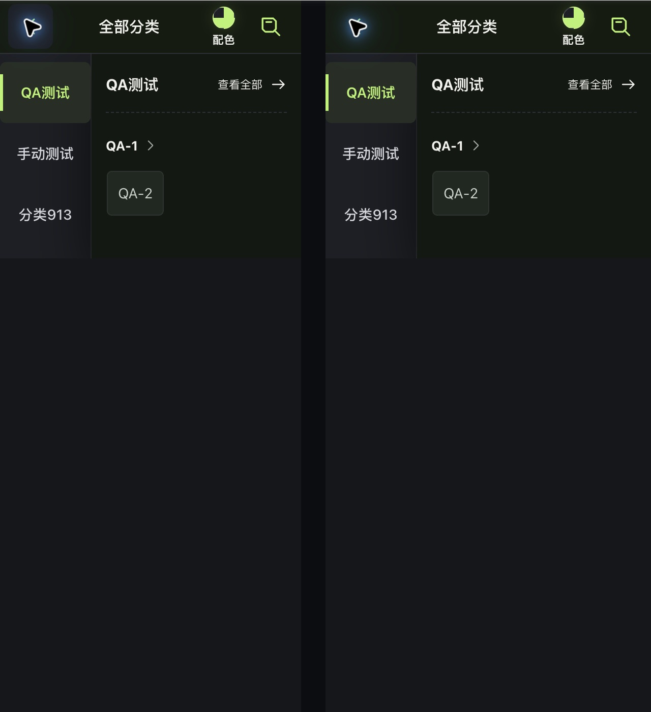
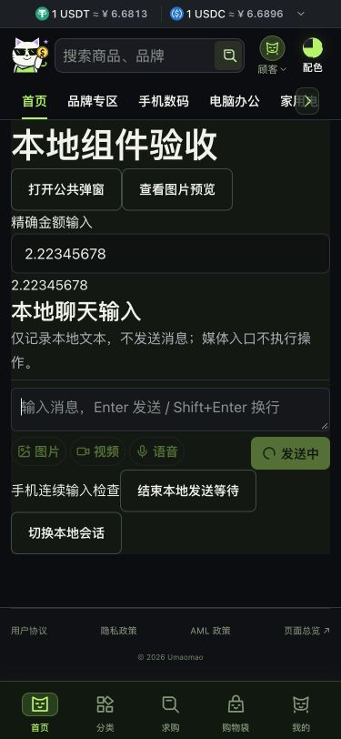

# v47 手机输入与分类页边界检查

2026-10-16，基线 `main@9ddd348`。本批局部修复与定向检查完成，v47 整体仍部分完成。保留此前未提交的图库修复与证据；没有提交、推送或发布，没有更新接口计划顶部承接状态。

## 本批修复

1. 手机消息输入：发送中不再禁用文本域，保留焦点及下一条草稿；手机点发送时保留已有文本域焦点。发送按钮与 send 方法继续检查 submitting，发送中不能重复提交。超过700px仍沿用原来的发送中禁用规则。
2. 键盘避让：失焦不等于键盘已收起。可见高度仍缩小时保留原高度基线与避让标记，避免重新聚焦后将缩小布局误当成正常高度；可见高度恢复后清理。非编辑状态不主动滚动，桌面不设置键盘标记。
3. 媒体生命周期：禁用、切换会话和卸载立即使旧上传失效；短暂禁用/会话改变再恢复也不会接收旧回包。视频元数据读取立即取消并释放计时器、事件、src及对象URL，旧确认不再上传。
4. 分类页焦点：Escape或点左侧收起搜索，nextTick后回到右侧搜索按钮；卸载或重新展开时忽略过期聚焦。
5. 分类页全宽：320px时主区域原为296px，通用wrap规则覆盖了分类全屏规则。只提高布局组件中既有<=700px规则的选择器优先级，恢复原本全屏设计；不修改冻结参考CSS、主题或PC规则。

消息组件和分类组件的style块与HEAD一致；布局组件只有上述手机媒体查询中的选择器变化。没有新依赖、测试文件、接口改造或后端整改，没有修改H5、包/锁文件、冻结CSS及素材。

## 执行步骤与有效证据

| 步骤 | 健康状态 | 当前证据及局限 |
| --- | --- | --- |
| 1 手机发送与下一条输入 | 修复后通过 | DEV components入口使用真实MessageInput，只记录本地文本，不发送业务消息，媒体点击在capture阶段阻断。375×812修前Enter后输入禁用且失焦，修后启用且保持焦点；下一条草稿可输入，旧记录不变。点发送另行复现并修复焦点转BODY，修后focused=true。见sending-focus-*.json、tap-focus-*.json、pending-next-draft.json及01/02截图 |
| 2 手机/PC分界 | 局部通过 | 700px发送中输入启用/16px；701及1440px发送中禁用/14px，键盘标记为空，无水平溢出。见send-breakpoints.json与pc-send-pending.json。不是整个PC页面像素回归 |
| 3 键盘状态与资源清理 | 受控回归通过 | latest-request.test.ts覆盖布局随键盘缩小、失焦/重聚焦、覆盖式键盘、纯缩放、PC、恢复和销毁。im.test.ts先复现5项失败，修后覆盖短暂禁用/会话变化、旧确认及视频资源立即释放。未调用真实麦克风、上传接口，未展示真实系统软键盘 |
| 4 分类页宽度与搜索 | 修复后通过 | Chrome 320×700真实分类树已加载；修前主区域296px，修后主区域和工具栏320px。375/700为全宽，701/1440隐藏手机工具栏并保留原桌面布局，无横向溢出。Esc与点收起后，DOM焦点均为打开分类搜索按钮。既有测试新增3项覆盖关闭、重开与卸载。见category-*.json及10/11原生截图 |
| 5 登录/注册/品牌窄屏 | 局部通过 | Chrome 320×700真实公共页面。登录/注册/品牌document与client均305px（15px桌面滚动条），无横向溢出，表单输入16px；分类为320px。品牌进入真实空结果并通过清空关键词发起恢复查询。注册确认密码后Tab两次到提交按钮，按钮y467.32–513.72，底部导航y636–700，不遮挡；仅聚焦，未填写凭据或注册。见public-pages.json与register-reachability.json |

## 截图取舍与清理

- 01/02原始截图375×812，保存后已打开检查，差异为发送中输入禁用/焦点状态，未改聊天UI或布局。DEV记录文本及工具按钮不属于生产消息界面。
- 登录/注册/分类早期扩展截图出现整窗缩成小图的比例错误，已拒收并删除，未算布局通过。原生注册截图一次为桌面尺寸、另一次切到其他任务页面，均拒收并移除；注册按钮可达性只采用目标标签的DOM/焦点证据。
- 07/08为本次目标页面的完整Chrome原生窗口，已打开核对品牌与登录布局。10/11为分类修前/修后完整窗口；13/14仅从各自原图截取 `(0,354)-(640,1754)`，不缩放，15为原尺寸并排。只用于本次宽度变化观察，不是同数据原型全页像素验收。
- Chrome扩展偶发超时，原生窗口可能被其他任务切走；未修改浏览器权限，未操作其他项目。最终已重置本次视口覆盖并关闭自己的检查标签；既有5173服务保留。

## 验证与剩余

现有9文件 **316项测试通过**，`pnpm typecheck`、参考契约（17CSS/129素材/50商品/27主题）、`git diff --check`通过。测试补充均放既有文件，没有新增框架。本批没有构建配置、依赖或交付流程变化，没有重复生产构建；没有真实消息、文件、账号、交易或资金写入。

仍未验证：真实手机系统键盘和刘海/底部安全区、旋转过程、真实媒体录制/上传，以及尚未覆盖的其他业务页面和重要状态。桌面浏览器尺寸覆盖和受控事件测试不能替代这些验收；本批不代表整站v47完成。下一步按既有清单继续同数据页面对照，真实业务闭环保持单列。
